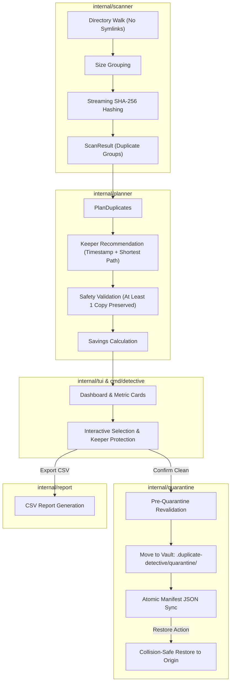

# Duplicate Detective ✦

[](https://go.dev/)
[](https://github.com/charmbracelet/bubbletea)
[](https://github.com/charmbracelet/lipgloss)
[](LICENSE)

**Duplicate Detective** is a terminal-native duplicate file identification, safe quarantine, and recovery system written in Go. Built with [Bubble Tea](https://github.com/charmbracelet/bubbletea) and [Lip Gloss](https://github.com/charmbracelet/lipgloss), it features a dark cyan terminal dashboard with deterministic keeper recommendation, non-destructive quarantine vaults, crash recovery, and CSV audit reporting.

---

## Features

- **High-Performance Streaming Scanner**:
  - Recursively scans target directories while strictly ignoring symlinks.
  - Groups candidates by exact file size before computing hashes.
  - Streaming SHA-256 hashing to handle large files with minimal memory overhead.
  - Detects duplicate sets of empty (0-byte) files while filtering out solitary empty files.
  - Excludes application metadata folders (`.duplicate-detective/`) and records unreadable files as non-fatal warnings.
- **Intelligent Keeper Planner**:
  - Recommends exactly one keeper file per duplicate group using oldest modification timestamp and shortest relative path as deterministic tie-breakers.
  - Documents human-readable rationale for keeper designations.
  - Enforces safety invariants: refuses to allow cleanup of all copies in any group.
  - Recalculates byte savings in real-time based strictly on selected files.
- **Safe Quarantine & Recovery Vault**:
  - Revalidates file type, size, and SHA-256 content hashes prior to relocation.
  - Isolates files under `.duplicate-detective/quarantine/files/<op-id>/` with unique operation IDs.
  - Maintains an atomic JSON manifest tracking explicit lifecycle states: `pending`, `quarantined`, `restored`, and `failed`.
  - Collision-proof restoration: refuses to overwrite files if a conflicting file exists at the original destination.
  - Startup reconciliation: recovers interrupted transfers, reports untracked or altered files, and preserves ambiguous files without purging.
- **Polished Interactive TUI**:
  - Multi-pane dashboard with real-time summary metric cards.
  - Arrow key navigation between duplicate groups and individual file inspection.
  - Interactive keeper protection that locks recommended originals against accidental selection.
  - Confirmation modals for quarantine operations.
  - Interactive quarantine history browser with single-key file restoration.
  - One-key CSV audit export (`group_id,path,size,hash,keeper,selection,savings`).

---

## Architecture Overview



---

## Installation & Requirements

### Prerequisites
- [Go](https://go.dev/dl/) 1.21 or later
- Standard terminal with ANSI / 256-color support

### Build from Source
Clone the repository and build the standalone binary:

```bash
git clone https://github.com/your-username/duplicate-detective.git
cd duplicate-detective
go build -o detective ./cmd/detective
```

---

## Quick Start

### 1. Launch Interactive TUI
```bash
# Launch with directory input prompt
./detective

# Launch directly on a target directory
./detective /path/to/directory
```

### 2. Try the Demo Sandbox
We include a demo generation script that creates a safe, isolated test directory containing duplicate documents, binary assets, 0-byte log files, unique files, and same-size non-duplicates:

```bash
# Generate the demo files
chmod +x scripts/create_demo.sh
./scripts/create_demo.sh demo_sandbox

# Run Duplicate Detective on the sandbox
./detective demo_sandbox
```

---

## Keyboard Controls

| Key | Context | Action |
| :--- | :--- | :--- |
| **`Enter`** | Path Input | Scan the entered directory |
| **`Enter`** | Groups Pane | Switch focus to inspect files in the highlighted group |
| **`Enter`** | Files Pane | Toggle selection of the highlighted duplicate file |
| **`Enter`** / **`U`** | Recovery View | Restore selected quarantined file to original location |
| **`↑ / ↓`** | Any Pane | Move cursor up / down |
| **`← / →`** | Dashboard | Switch between **Duplicate Groups** and **Files** panels |
| **`Space`** | Files Pane | Toggle selection for cleanup (**Keeper is automatically protected**) |
| **`Space`** | Groups Pane | Toggle selection of all duplicates in the group (excluding keeper) |
| **`A`** | Dashboard | Select **all** duplicate copies across all groups (keepers preserved) |
| **`C`** | Dashboard | Open **Quarantine Confirmation** dialog |
| **`E`** | Dashboard | Export audit report to CSV (`duplicate-detective-report-<timestamp>.csv`) |
| **`R`** / **`U`** | Dashboard | Open **Quarantine Recovery History & Restore Vault** |
| **`/`** | Dashboard | Return to path prompt to scan another directory |
| **`Esc`** | Modal / Sub-pane | Cancel, dismiss modal, or return to groups panel |
| **`Q`** / **`Ctrl+C`** | Any View | Quit Duplicate Detective |

---

## Safety & Data Integrity Guarantees

1. **Keeper Protection Invariant**:
   Recommended keeper files cannot be selected for deletion in the UI. Attempting to select a keeper displays an explicit protection notice (`Protected: Keeper file cannot be selected for deletion`).
2. **Anti-Purge Guard**:
   The planner prevents selecting all copies in any duplicate group. At least one original copy must always be preserved.
3. **Pre-Quarantine Revalidation**:
   Before moving any file into quarantine, Duplicate Detective re-checks:
   - File exists and is a regular file (not a symlink or directory).
   - Size matches expected byte length.
   - SHA-256 hash matches the scan result.
4. **Collision-Safe Restoration**:
   When restoring a quarantined file, if another file has since been created at the original destination path, the restore operation is rejected with `ErrOriginalFileExists`. Neither file is overwritten.
5. **Crash Recovery & Reconciliation**:
   On startup, the quarantine manager inspects `.duplicate-detective/quarantine/` and verifies manifest entries against disk:
   - Interrupted moves are resolved safely.
   - Untracked or corrupted files are preserved without purging.
   - Recovery inconsistencies are displayed as warnings in the TUI.

---

## CSV Export Format

Exported audit reports generated via **`E`** adhere to the standardized schema:

```csv
group_id,path,size,hash,keeper,selection,savings
group-1,/workspace/demo_sandbox/documents/report.txt,74,5d08032cc4b4...,true,false,0
group-1,/workspace/demo_sandbox/downloads/report_backup.txt,74,5d08032cc4b4...,false,true,74
group-1,/workspace/demo_sandbox/archive/old/report_copy.txt,74,5d08032cc4b4...,false,true,74
```

---

## Project Structure

```
duplicate-detective/
├── cmd/
│   └── detective/          # Application entrypoint & CLI flag parser
│       └── main.go
├── internal/
│   ├── scanner/            # Filesystem traversal, size grouping, streaming SHA-256
│   │   ├── scanner.go
│   │   └── scanner_test.go
│   ├── planner/            # Keeper selection, deterministic tie-breakers, safety rules
│   │   ├── planner.go
│   │   └── planner_test.go
│   ├── quarantine/         # Vault isolation, atomic manifest, safe restore, reconciliation
│   │   ├── quarantine.go
│   │   ├── reconcile.go
│   │   └── quarantine_test.go
│   ├── report/             # CSV report exporter and data schemas
│   │   ├── report.go
│   │   └── report_test.go
│   └── tui/                # Bubble Tea model, view rendering, adapter bridge, styling
│       ├── adapter.go
│       ├── model.go
│       ├── styles.go
│       ├── views.go
│       └── tui_test.go
├── scripts/
│   └── create_demo.sh      # Sandbox generator script for hands-on testing
├── go.mod
├── go.sum
└── README.md
```

---

## Running Unit Tests

Run the full automated test suite across all packages:

```bash
go test -v ./...
```

To run tests with race detection:

```bash
go test -race ./...
```

---

## License

This project is licensed under the MIT License. See [LICENSE](LICENSE) for details.
